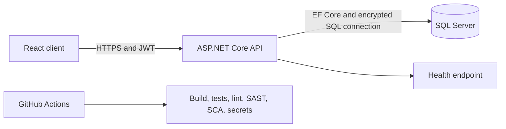
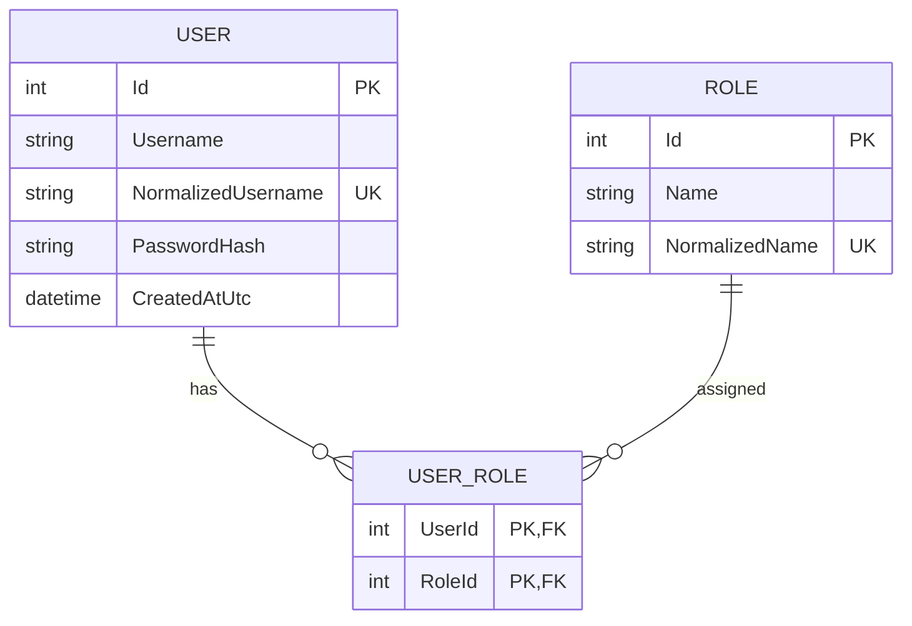

# Architecture

## Overview

The solution is a React single-page application backed by an ASP.NET Core REST API and SQL Server. The API owns authentication, authorization, validation, persistence, and role assignment. The browser stores the short-lived access token in `sessionStorage`, reducing persistence across browser restarts while keeping the implementation simple.

## API structure

- `Controllers`: HTTP boundary and authorization policies.
- `Contracts`: validated request and response models.
- `Services`: business use cases and mapping.
- `Domain`: user, role, and join entities.
- `Data`: EF Core configuration and controlled seed logic.
- `Middleware`: RFC 7807 errors and security headers.

This is deliberately a modular monolith. It keeps the exercise easy to run while preserving clear boundaries that can later be extracted if the domain grows.

## Entity relationship model

## Security decisions

- Passwords use BCrypt cost factor 12.
- JWT validates signature, issuer, audience, and lifetime with 30 seconds clock skew.
- User creation and role assignment require `SuperAdmin`.
- SQL Server connections require `Encrypt=True`. Local Docker uses `TrustServerCertificate=True` only because it has no trusted local CA.
- CORS uses an explicit allowlist.
- Global rate limiting provides a basic abuse control.
- API errors use `ProblemDetails` and do not expose stack traces.
- Production secrets are supplied through environment variables or a managed secret store.

For a production deployment, prefer Azure Key Vault, Azure SQL with Microsoft Entra workload identity, managed TLS certificates, an API gateway or WAF, centralized audit logs, and refresh-token rotation or an external OpenID Connect provider.
