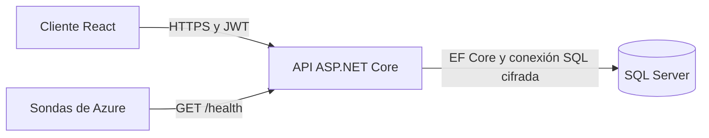
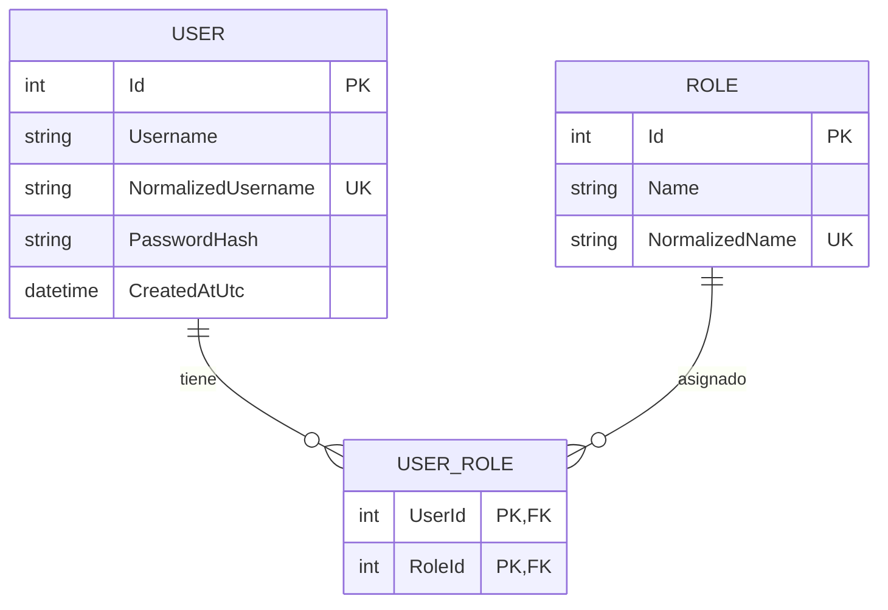

# Arquitectura

## Visión general (`Overview`)

La solución es una aplicación *single-page* de React conectada a una REST API en ASP.NET Core y SQL Server. La API gestiona la autenticación, autorización, validación, persistencia y asignación de roles. El navegador almacena el *access token* de corta duración en `sessionStorage`, lo que reduce la persistencia entre reinicios del navegador al tiempo que mantiene una implementación sencilla.

## Estructura de la API

- `Controllers`: límite HTTP y políticas de autorización (`authorization policies`).
- `Contracts`: modelos de solicitud (`request`) y respuesta (`response`) validados.
- `Services`: casos de uso de negocio y mapeo (un archivo por clase o interfaz; excepciones de dominio en `Exceptions.cs`).
- `Domain`: entidades de usuario, rol y tablas de unión (`join entities`).
- `Data`: configuración de EF Core, migraciones (`Data/Migrations`) y *seed* idempotente.
- `Middleware`: manejador global de excepciones que devuelve errores RFC 7807 sin exponer detalles internos.
- `Options`: opciones tipadas (`Jwt`, `Seed`, `Database`, `RateLimiting`).

El cliente (`Front/src`) mantiene la sesión en un *context* de React (`auth.tsx`), llama a la API desde `api.ts` (respuestas validadas con zod) y divide el panel en `components/` (`CreateUserForm`, `UsersTable`, `UserRolesEditor`).

Se trata deliberadamente de un monolito modular (*modular monolith*). Mantiene el ejercicio fácil de ejecutar a la vez que preserva límites claros que se pueden extraer más adelante si el dominio crece.

## Modelo entidad-relación (`Entity relationship model`)

## Decisiones de seguridad

- Las contraseñas utilizan BCrypt con un *cost factor* de 12.
- JWT valida la firma (*signature*), emisor (*issuer*), audiencia (*audience*) y tiempo de vida (*lifetime*) con una tolerancia de reloj (*clock skew*) de 30 segundos.
- La creación de usuarios y la asignación de roles requieren `SuperAdmin`. Un usuario no puede quedarse sin roles y un SuperAdmin no puede quitarse a sí mismo el rol `SuperAdmin` (409).
- El login verifica un hash ficticio cuando el usuario no existe, para no revelar usuarios por diferencias de tiempo, y tiene su propio límite (5 intentos por minuto por IP).
- La entrada se valida con DataAnnotations; `[ApiController]` responde `400` con `ValidationProblemDetails`.
- Las conexiones a SQL Server usan `Encrypt=True`. La configuración local añade `TrustServerCertificate=True` solo porque SQL Server Express usa un certificado autofirmado; no lo copies a producción.
- CORS utiliza una lista de permitidos explícita (*allowlist*); la API no arranca si contiene `*`.
- El *rate limiting* global proporciona un control básico contra abusos.
- Los errores de la API utilizan `ProblemDetails` y no exponen trazados de pila (*stack traces*).
- Los secretos nunca están en archivos versionados: `dotnet user-secrets` en local y variables de entorno o *Key Vault references* en Azure.
- El cliente cierra la sesión al expirar el token, ante cualquier `401` de una petición autenticada y limpia la caché de TanStack Query al salir.

Para un despliegue en producción, se aconseja utilizar Azure Key Vault, Azure SQL con identidad de trabajo de Microsoft Entra (*workload identity*), certificados TLS gestionados, un *API gateway* o WAF, registros de auditoría centralizados (*centralized audit logs*) y rotación de *refresh tokens* o un proveedor externo de OpenID Connect.
