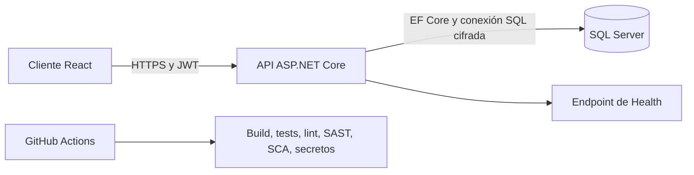
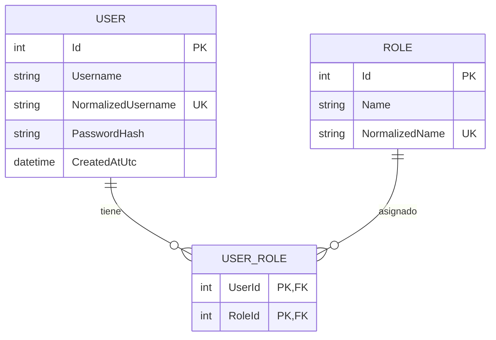

# Arquitectura

## Visión general (`Overview`)

La solución es una aplicación *single-page* de React conectada a una REST API en ASP.NET Core y SQL Server. La API gestiona la autenticación, autorización, validación, persistencia y asignación de roles. El navegador almacena el *access token* de corta duración en `sessionStorage`, lo que reduce la persistencia entre reinicios del navegador al tiempo que mantiene una implementación sencilla.

## Estructura de la API

- `Controllers`: límite HTTP y políticas de autorización (`authorization policies`).
- `Contracts`: modelos de solicitud (`request`) y respuesta (`response`) validados.
- `Services`: casos de uso de negocio y mapeo.
- `Domain`: entidades de usuario, rol y tablas de unión (`join entities`).
- `Data`: configuración de EF Core y lógica controlada de *seed*.
- `Middleware`: errores RFC 7807 y cabeceras de seguridad (`security headers`).

Se trata deliberadamente de un monolito modular (*modular monolith*). Mantiene el ejercicio fácil de ejecutar a la vez que preserva límites claros que se pueden extraer más adelante si el dominio crece.

## Modelo entidad-relación (`Entity relationship model`)

## Decisiones de seguridad

- Las contraseñas utilizan BCrypt con un *cost factor* de 12.
- JWT valida la firma (*signature*), emisor (*issuer*), audiencia (*audience*) y tiempo de vida (*lifetime*) con una tolerancia de reloj (*clock skew*) de 30 segundos.
- La creación de usuarios y la asignación de roles requieren `SuperAdmin`.
- Las conexiones a SQL Server requieren `Encrypt=True`. El Docker local usa `TrustServerCertificate=True` únicamente porque no dispone de una CA local de confianza.
- CORS utiliza una lista de permitidos explícita (*allowlist*).
- El *rate limiting* global proporciona un control básico contra abusos.
- Los errores de la API utilizan `ProblemDetails` y no exponen trazados de pila (*stack traces*).
- Los secretos de producción se suministran mediante variables de entorno o un almacén de secretos gestionado (*managed secret store*).

Para un despliegue en producción, se aconseja utilizar Azure Key Vault, Azure SQL con identidad de trabajo de Microsoft Entra (*workload identity*), certificados TLS gestionados, un *API gateway* o WAF, registros de auditoría centralizados (*centralized audit logs*) y rotación de *refresh tokens* o un proveedor externo de OpenID Connect.
